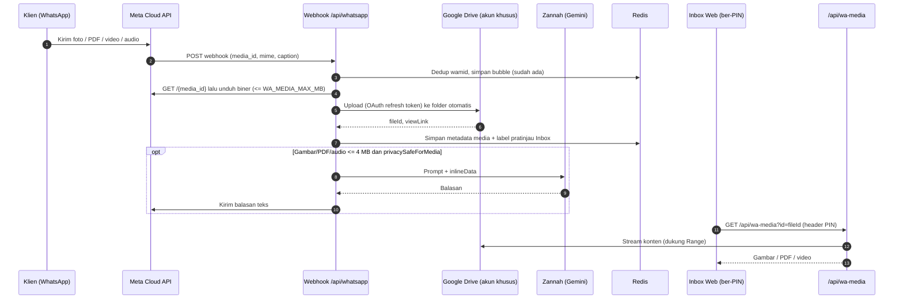

# Rencana Implementasi (Rev. 2): Integrasi Media WhatsApp & Arsip Google Drive

Dokumen ini memuat arsitektur, konfigurasi, struktur data, daftar file, dan fase pelaksanaan untuk mengarsipkan lampiran WhatsApp (gambar, PDF/dokumen, video, audio) ke **Google Drive akun khusus**, lalu menampilkannya di **Inbox WhatsApp** portfolio.

> **Status:** Fase 2–5b selesai (helper backend, webhook, proxy + bubble Inbox, kirim lampiran manual termasuk berkas besar via Drive). Fase 1 menunggu setup dari Mas Arzha. Fase 6 (test akhir & deploy) belum dikerjakan.

## 0. Perubahan dari Rev. 1

| # | Rev. 1 | Rev. 2 | Alasan |
|:--|:--|:--|:--|
| 1 | Autentikasi **Service Account** | **OAuth2 refresh token** milik Gmail khusus | Service Account tidak punya kuota storage di My Drive Gmail biasa; upload gagal dengan `Service Accounts do not have storage quota`. Solusi resmi (Shared Drive) butuh Workspace berbayar. |
| 2 | Folder dibuat manual, ID disalin ke env | Folder **dibuat otomatis** (scope `drive.file`) dan dibagikan ke email pribadi | Scope `drive.file` hanya bisa mengakses file/folder buatan app sendiri. Setup user lebih singkat. |
| 3 | Inbox menampilkan `thumbnailLink` / link Drive langsung | **Endpoint proxy** `api/wa-media.ts` ber-PIN | `thumbnailLink` berumur pendek dan `webViewLink` butuh login Google; `` di Inbox tidak akan tampil. File klien juga tidak perlu dibuat publik. |
| 4 | Unggah lampiran manual lewat `wa-inbox` | Dibatasi ±4 MB, atau upload langsung dari browser | Batas body request Vercel Function 4,5 MB. |
| 5 | Pengiriman keluar via `mediaUrl` | Pengiriman keluar via **`media id`** hasil upload ke Meta | Link Drive bukan URL langsung yang bisa diambil Meta. |
| 6 | "1.000 percakapan gratis, media tidak berbiaya" | Penjelasan biaya diperbarui (bagian 10) | Aturan harga WABA berubah per 1 Okt 2026. |
| 7 | Batas aman 15 MB tanpa dasar | Batas dapat diatur `WA_MEDIA_MAX_MB` (default 15, maks 25); batas inline Gemini tetap 4 MB | Dua kebutuhan berbeda: arsip vs. analisis AI. |
| 8 | Asumsi media belum diproses sama sekali | Menyesuaikan kode yang **sudah ada** (bagian 2) | Webhook sudah mengunduh media dan mengirimnya ke Gemini. |

---

## 1. Prinsip Arsitektur

* **Serverless & zero server cost:** semua proses berjalan on-demand di Vercel Functions.
* **Storage terpisah:** akun Gmail khusus (misal `arzha.chatbot@gmail.com`) dengan kuota 15 GB utuh, terpisah dari email dan Google Photos pribadi. Folder otomatis dibagikan sebagai Editor ke `jarzha@gmail.com` sehingga file klien bisa dibuka dari aplikasi Drive di HP.
* **Redis hanya menyimpan metadata** (ID file Drive, nama, MIME, ukuran, caption). Tidak ada binary di Redis.
* **Privasi:** file klien **tidak dibuat publik** ("anyone with the link"). Inbox mengaksesnya lewat proxy ber-PIN.
* **Kegagalan Drive tidak boleh mematikan bot:** jika upload gagal, pipeline Zannah tetap berjalan; media hanya tidak diarsipkan.
* **Tanpa dependensi baru:** Drive API dipanggil dengan `fetch` native.

---

## 2. Kondisi Codebase Saat Ini (Temuan)

Hasil membaca file yang dikirim:

| Area | Kondisi sekarang | Dampak ke rencana |
|:--|:--|:--|
| Unduh media masuk | `downloadWhatsAppMediaAsBase64` di `whatsappGraph.ts`: batas 4 MB, timeout 10 dtk, keluaran base64 | Dipertahankan untuk Gemini. Arsip Drive memakai fungsi baru yang mengembalikan `Buffer`. |
| Gemini multimodal | Sudah ada (`inlineData`), maks 2 media per giliran, **hanya jika `privacySafeForMedia`** (key berbayar / Vertex) | Fase 3 tidak perlu membangun multimodal dari nol. Arsip Drive **tidak bergantung** pada flag ini. |
| Tipe pesan webhook | `image`, `audio`, `document` sudah diekstrak ke `PendingBubble` | `video` belum ditangani; ditambahkan di Fase 3. |
| Dedup & burst | `claimMessageDedup`, jeda pintar (`WA_SMART_DELAY_MS=15000`), `maxDuration` 60 dtk untuk `api/whatsapp.ts` | Dedup sudah ada, tidak perlu dibuat. Proses arsip harus muat dalam 60 dtk. |
| `WaChatTurn` | `parts: { text: string }[]`, tanpa media | Diperluas dengan `media?` (opsional, kompatibel mundur). |
| `appendWaHistory` | Hanya menerima teks | Ditambah parameter lampiran. |
| `wa-inbox.ts` | Hanya `reply` teks / `pause` / `resume`; `maxDuration` ditulis sebagai `export const` | Ditambah aksi lampiran. `maxDuration` yang efektif ada di `vercel.json`, bukan di export. |
| Kuota Meta | `reserveMetaReplyQuota` dipakai bot, **tidak** dipakai balasan manual di `wa-inbox` | Balasan manual (termasuk lampiran) perlu ikut menghitung kuota (Fase 5). |
| Dokumen keluar | AI membuat draf RAB via `buildAgentDocumentAttachment`, tetapi balasan ke WA tetap teks | Pengiriman dokumen via Meta belum ada; dibangun di Fase 5. |

---

## 3. Arsitektur & Alur Kerja

### 3.1 Pesan Masuk (Klien → Drive → Inbox)



**Keputusan penempatan (dikonfirmasi saat Fase 3 setelah membaca `handleSingleInboundMessage`):** arsip dilakukan **saat pesan diterima**, bukan setelah jeda 15 dtk dan panggilan AI. Alasannya: (a) file tetap terarsip walau bot sedang di-pause/skip karena Mas Arzha mengambil alih, (b) Inbox langsung menampilkan lampiran, (c) kegagalan AI tidak menghilangkan file. Konsekuensinya: Gemini mengunduh ulang dari Meta (media_id berlaku jauh lebih lama dari URL unduhannya) atau memakai buffer yang sama bila masih dalam satu invokasi.

### 3.2 Balasan Manual dengan Lampiran (Mas Arzha → Klien)

1. Mas Arzha memilih file lewat ikon 📎 di composer Inbox.
2. Frontend mengirim file ke `/api/wa-inbox` (aksi `reply_media`), maksimal **3 MB** mentah (base64 dalam JSON harus muat di batas body Vercel 4,5 MB; foto dikompres otomatis di browser). File lebih besar: Fase 5b (upload langsung ke Drive via resumable session).
3. Backend memeriksa **jendela 24 jam** (pesan klien terakhir). Di luar jendela, Meta menolak pesan bebas; UI menampilkan pesan error jelas.
4. Backend: upload ke Meta `POST /{phone_number_id}/media` → dapat `media id` → kirim pesan `document`/`image` memakai `media id`.
5. Salinan file diarsipkan ke Drive, riwayat Inbox ditandai `[Mas Arzha]` beserta metadata lampiran, bot di-pause 2 jam (perilaku yang sudah ada).
6. Kuota pesan keluar bulanan dihitung (`reserveMetaReplyQuota`) dan dikembalikan jika gagal.

---

## 4. Struktur Data

Didefinisikan di `api/_lib/whatsappMedia.ts` (Fase 2). Pada Fase 3 tipe ini di-*re-export* dari `whatsappState.ts` agar semua modul mengimpor dari satu tempat.

```typescript
export type WaMediaKind = 'image' | 'document' | 'video' | 'audio';

export interface WaMediaAttachment {
  type: WaMediaKind;
  driveFileId: string;
  driveViewLink: string;        // untuk "Buka di Drive" (butuh login Google)
  driveThumbnailLink?: string;  // sementara; Inbox memakai proxy, bukan link ini
  fileName?: string;            // nama asli, mis. "RAB_Aplikasi_V1.pdf"
  mimeType: string;
  fileSizeBytes?: number;
  caption?: string;
}

// Fase 3: perluasan kompatibel mundur
export interface WaChatTurn {
  role: 'user' | 'model';
  parts: { text: string }[];
  media?: WaMediaAttachment[];  // baru, opsional
}
```

Catatan:
* Metadata media mengikuti TTL Redis yang sudah ada untuk riwayat/Inbox. File di Drive tetap ada setelah metadata kedaluwarsa. Karena nama file Drive memuat tanggal & nomor, file masih mudah dicari manual.
* Nama file di Drive: `YYYY-MM-DD_HHmm_<nomor>_<nama asli>` (jam WIB), mis. `2026-11-21_0030_628123456789_Spesifikasi.pdf`.
* Transkrip dibatasi 30 giliran; metadata kecil sehingga tidak membebani Redis.

---

## 5. Setup Google (Satu Kali, ±15 Menit)

### Langkah 1 — Akun & Google Cloud
1. Buat akun Gmail khusus (misal `arzha.chatbot@gmail.com`).
2. Buka [Google Cloud Console](https://console.cloud.google.com) (project baru atau yang sudah ada) → aktifkan **Google Drive API**.
3. **OAuth consent screen**: pilih *External*, isi nama app, tambahkan akun khusus sebagai *Test user*, lalu ubah status ke **In production**. Jika dibiarkan *Testing*, refresh token **kedaluwarsa tiap 7 hari**. Scope `drive.file` tidak memerlukan verifikasi Google untuk pemakaian pribadi (akan muncul layar "app belum diverifikasi" saat login; pilih *Advanced → Continue*).
4. **Credentials → Create credentials → OAuth client ID → Desktop app.** Salin Client ID dan Client Secret.

### Langkah 2 — Ambil Refresh Token
1. Isi `GDRIVE_CLIENT_ID` dan `GDRIVE_CLIENT_SECRET` di `.env.local`.
2. Jalankan `npm run google:auth`, buka URL yang tercetak, login dengan **akun Gmail khusus**, izinkan akses.
3. Terminal mencetak akun yang terhubung, sisa kuota, dan baris `GDRIVE_REFRESH_TOKEN="..."`.
4. Jika Google tidak mengembalikan refresh token (akses pernah diberikan sebelumnya), cabut akses di <https://myaccount.google.com/permissions> lalu ulangi.

### Langkah 3 — Environment Variable (Vercel & `.env.local`)

```env
GDRIVE_CLIENT_ID=""
GDRIVE_CLIENT_SECRET=""
GDRIVE_REFRESH_TOKEN=""
GDRIVE_FOLDER_NAME="WhatsApp-Bot-Media"   # opsional
GDRIVE_SHARE_EMAIL="jarzha@gmail.com"     # folder otomatis dibagikan sebagai Editor
GDRIVE_FOLDER_ID=""                       # opsional, kosongkan kecuali folder dibuat oleh client OAuth yang sama
WA_MEDIA_MAX_MB="15"                      # opsional (1–25)
```

Folder `WhatsApp-Bot-Media` dibuat otomatis pada upload pertama. Setelah itu muncul di bagian *Shared with me* pada akun `jarzha@gmail.com` (tidak ada email notifikasi). Tambahkan pintasan ke My Drive jika ingin lebih mudah diakses.

---

## 6. Matriks File

| No | File | Status | Fase | Peran |
|:--|:--|:--:|:--:|:--|
| 1 | `api/_lib/googleDrive.ts` | **BARU ✅** | 2 | Klien Drive v3: OAuth refresh token, folder otomatis + berbagi, upload multipart, metadata, stream konten (Range). |
| 2 | `api/_lib/whatsappMedia.ts` | **BARU ✅** | 2 | Unduh media Meta sebagai Buffer (whitelist MIME, validasi host & ukuran), arsip ke Drive, nama file aman, label pratinjau. |
| 3 | `api/_lib/whatsappGraph.ts` | **UPDATE ✅ (minor)** | 2 | Hanya `export` untuk `GRAPH_BASE_URL` dan `isAllowedMetaMediaHost`. Fungsi kirim media menyusul di Fase 5. |
| 4 | `scripts/google-drive-auth.mjs` | **BARU ✅** | 1/2 | Mengambil refresh token sekali jalan. |
| 5 | `package.json` | **UPDATE ✅** | 2 | Script `google:auth`. Tanpa dependensi baru. |
| 6 | `.env.example` | **UPDATE ✅** | 2 | Variabel `GDRIVE_*` dan `WA_MEDIA_MAX_MB`. |
| 7 | `api/__tests__/googleDrive.test.ts` | **BARU ✅** | 2 | 13 test (token, folder, upload, metadata). |
| 8 | `api/__tests__/whatsappMedia.test.ts` | **BARU ✅** | 2 | 17 test (unduh, whitelist, batas ukuran, arsip, toleransi gagal). |
| 9 | `api/whatsapp.ts` | UPDATE | 3 | Tangani `video`; panggil `processInboundMedia` saat pesan masuk; catat metadata & label Inbox; Gemini tetap mengikuti `privacySafeForMedia` dan batas 4 MB. |
| 10 | `api/_lib/whatsappState.ts` | UPDATE | 3 | Re-export tipe media; `WaChatTurn.media?`; `PendingBubble.media?`; `appendWaHistory` menerima lampiran; `lastMessage` Inbox memakai label bila tanpa caption. |
| 11 | `api/wa-media.ts` | **BARU ✅** | 4 | Proxy ber-PIN: stream file Drive ke Inbox (Range, `Content-Type` dari metadata, `nosniff`, tanpa cache publik). |
| 12 | `src/components/WaInboxTab.tsx` + `WaMediaBubble.tsx` | UPDATE ✅ (4) / 5 menyusul | 4 & 5 | Bubble media (gambar + lightbox, kartu dokumen, audio/video player), tombol 📎, progress upload. |
| 13 | `api/_lib/whatsappGraph.ts` | UPDATE | 5 | `uploadMetaMedia`, `sendWhatsAppMediaMessage({ to, type, mediaId, caption, filename })` dengan penjaga 131021 yang sama. |
| 14 | `api/wa-inbox.ts` | UPDATE | 5 | Aksi `reply_media`: validasi jendela 24 jam, kuota, upload Meta → kirim → arsip Drive → riwayat. |
| 15 | `vercel.json` | UPDATE | 4/5 | `functions` untuk `api/wa-inbox.ts` (mis. 30 dtk) dan `api/wa-media.ts` (30 dtk). Export `maxDuration` di file TS tidak dipakai Vercel. |
| 16 | `api/__tests__/whatsapp.test.ts` | UPDATE | 3 & 6 | Webhook foto/PDF/video dengan mock Drive; 17 test lama tetap hijau; test `reply_media` dan proxy. |

---

## 7. Detail Per File (Yang Sudah Dibuat)

### `api/_lib/googleDrive.ts`
* `getGoogleDriveConfig()` / `isGoogleDriveConfigured()`: membaca env (mengabaikan tanda kutip pembungkus), melaporkan variabel yang kurang.
* `getGoogleDriveAccessToken()`: menukar refresh token, cache sampai ±1 menit sebelum kedaluwarsa; 401 → refresh ulang sekali. Galat `invalid_grant` (token dicabut/kedaluwarsa) dilempar sebagai `GoogleDriveError` dengan `code`.
* `ensureMediaFolder()`: `GDRIVE_FOLDER_ID` → cache → cari berdasarkan nama → buat baru dan bagikan ke `GDRIVE_SHARE_EMAIL` (gagal berbagi hanya memberi peringatan). Catatan: dua cold start bersamaan pada upload **pertama** bisa membuat folder ganda; pencarian memilih yang tertua sehingga akhirnya konsisten.
* `uploadFileToDrive({ buffer, fileName, mimeType })`: multipart upload (cocok untuk ≤ ±25 MB).
* `getDriveFileMetadata(fileId)`, `fetchDriveFileContent(fileId, range?)`: dipakai proxy di Fase 4. ID file divalidasi regex sebelum dipakai di URL.

### `api/_lib/whatsappMedia.ts`
* `downloadWhatsAppMediaBuffer`: validasi `media_id`, host unduhan (daftar host Meta yang sama dengan kode lama), whitelist MIME (JPEG/PNG/WebP, MP4/3GP, OGG/MP3/M4A/AAC/AMR, PDF, DOC/DOCX, XLS/XLSX, PPT/PPTX, TXT), batas ukuran dicek dua kali (metadata dan isi sebenarnya). Mengembalikan alasan gagal yang terstruktur (`too_large`, `unsupported_type`, …) agar Fase 3 bisa memberi balasan yang sesuai.
* `processInboundMedia`: unduh → arsip Drive → `WaMediaAttachment`. Mengembalikan `buffer` agar bisa dipakai ulang untuk Gemini. Drive belum dikonfigurasi / upload gagal → `ok: true` dengan `driveError`, tanpa melempar.
* `sanitizeDriveFileName`, `buildDriveFileName`, `buildMediaPreviewLabel`.

---

## 8. Roadmap

| Fase | Fokus | Estimasi | Output | Status |
|:--|:--|:--|:--|:--:|
| 1 | Setup akun Google, OAuth client, jalankan `npm run google:auth`, isi env | 15 mnt (Mas Arzha) | `GDRIVE_*` terisi di Vercel | ⏳ Menunggu |
| 2 | `googleDrive.ts`, `whatsappMedia.ts`, script auth, env, test | — | Helper backend teruji (30 test hijau, typecheck bersih) | ✅ Selesai |
| 3 | Webhook inbound: `video`, arsip saat pesan masuk, metadata & label Inbox, `whatsappState` | ±30 mnt | File klien otomatis masuk Drive; Gemini tetap berfungsi | ✅ |
| 4 | Proxy `wa-media.ts` + bubble media di `WaInboxTab.tsx` | ±40 mnt | Foto/PDF/video/audio tampil di Inbox | ✅ |
| 5 | Kirim lampiran manual (jendela 24 jam, kuota, media id) | ±30 mnt | Mas Arzha kirim PDF/foto dari Inbox | ✅ |
| 5b | File > 3 MB via upload langsung ke Drive (sesi resumable) | ±30 mnt | Lampiran hingga 15 MB | ✅ |
| 6 | Test akhir, `vercel.json`, deploy | ±15 mnt | Live di production | ⬜ |

Fase 2 sengaja dipilih sebagai langkah pertama: seluruhnya file baru, tidak mengubah perilaku produksi (satu-satunya perubahan di file lama hanyalah kata `export`), dan bisa diuji penuh tanpa kredensial asli.

---

## 9. Risiko & Mitigasi

1. **Refresh token kedaluwarsa/dicabut** (consent screen masih *Testing*, password akun diganti, akses dicabut). Gejala: `invalid_grant`. Mitigasi: set *In production*; kegagalan arsip tidak mematikan bot; log jelas. Pertimbangkan notifikasi ke Mas Arzha saat `invalid_grant` (Fase 3).
2. **Timeout serverless.** Unduh + upload bisa belasan detik untuk file besar. `api/whatsapp.ts` sudah 60 dtk; timeout per langkah 25 dtk. Batas ukuran default 15 MB. Meta membatasi dokumen hingga 100 MB, jadi file di atas batas kita **tidak diarsipkan** dan bot memberi tahu pengirim dengan sopan.
3. **Batas 4,5 MB request/response Vercel Function.** Upload manual dibatasi ±4 MB (Fase 5b untuk yang lebih besar). Respons proxy harus di-*stream* agar video besar tidak terkena batas.
4. **Privasi file klien.** Tidak ada izin publik; akses hanya via akun khusus, akun pribadi Mas Arzha (berbagi folder), dan proxy ber-PIN. `Content-Type` proxy diambil dari metadata tervalidasi + `X-Content-Type-Options: nosniff`.
5. **Konten berbahaya dari pengirim tak dikenal.** Whitelist MIME ketat (tanpa arsip/executable/HTML/SVG), nama file disanitasi, host unduhan divalidasi, rate-limit pengirim yang sudah ada tetap berlaku.
6. **Kuota Drive 15 GB.** Cukup untuk beberapa ribu foto/PDF. Tambahkan peringatan saat pemakaian > 80% (opsional, memakai `about.storageQuota`).
7. **Kredensial.** `GDRIVE_CLIENT_SECRET` dan `GDRIVE_REFRESH_TOKEN` hanya di Vercel env / `.env.local` (jangan di-commit). Scope `drive.file` membatasi dampak jika bocor: hanya file buatan app ini yang terjangkau, bukan seluruh Drive.

---

## 10. Biaya (Diperbarui)

### 10.1 WhatsApp Cloud API (Meta)
* **Pesan masuk dari klien (termasuk foto/dokumen/video) gratis.** Unduh media via `GET /{media_id}` dan unggah media via `POST /{phone_number_id}/media` tidak dikenai biaya terpisah.
* **Pesan keluar bebas (service message) di dalam jendela 24 jam** mulai **1 Oktober 2026** ditagih **per pesan**, dengan **1.000 pesan layanan gratis per bulan** (sumber berbeda menyebut "per nomor" atau "per WABA"; cek halaman *Pricing* di dashboard Meta untuk angka dan tarif Indonesia yang berlaku). Ini menggantikan skema lama "pesan layanan gratis tak terbatas".
* Implikasinya untuk fitur ini: **setiap lampiran yang dikirim Mas Arzha dihitung 1 pesan keluar**, sama seperti teks. Karena itu aksi `reply_media` ikut `reserveMetaReplyQuota` (Fase 5), dan batas `WA_MONTHLY_MESSAGE_LIMIT` yang sudah ada tetap menjadi pagar pengaman.
* Pesan keluar di luar jendela 24 jam hanya bisa lewat *template* (berbayar) dan di luar cakupan fitur ini.

### 10.2 Token AI (Gemini)
* Gambar kecil (≤ 384 px kedua sisi) ≈ 258 token. **Foto biasa dipecah menjadi beberapa tile**, jadi perkirakan sekitar 258–1.500 token per foto; tetap sangat murah, dan `recordAiSpendIdr` / `hasAiBudgetRemaining` yang sudah ada menjadi pagar anggaran.
* Perilaku saat ini dipertahankan: maksimal 2 media per giliran, inline ≤ 4 MB, hanya jika `privacySafeForMedia`. Video dan dokumen besar **tidak dikirim ke AI**; Zannah hanya menerima teks ringkas seperti `[Pengirim mengirimkan file dokumen: Spesifikasi_Proyek.pdf]` dan membalas bahwa file sudah tersimpan dan akan dilihat Mas Arzha.
* Arsip Drive tidak memakai token AI sama sekali.

### 10.3 Google Drive
* Kuota 15 GB akun Gmail gratis. Drive API v3 gratis dengan kuota harian yang jauh melampaui kebutuhan ini.
